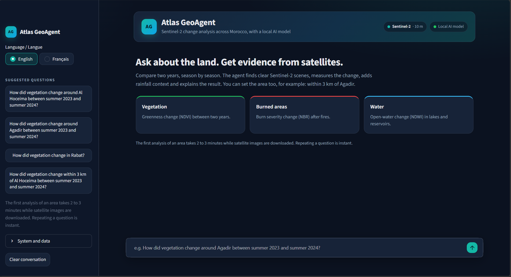
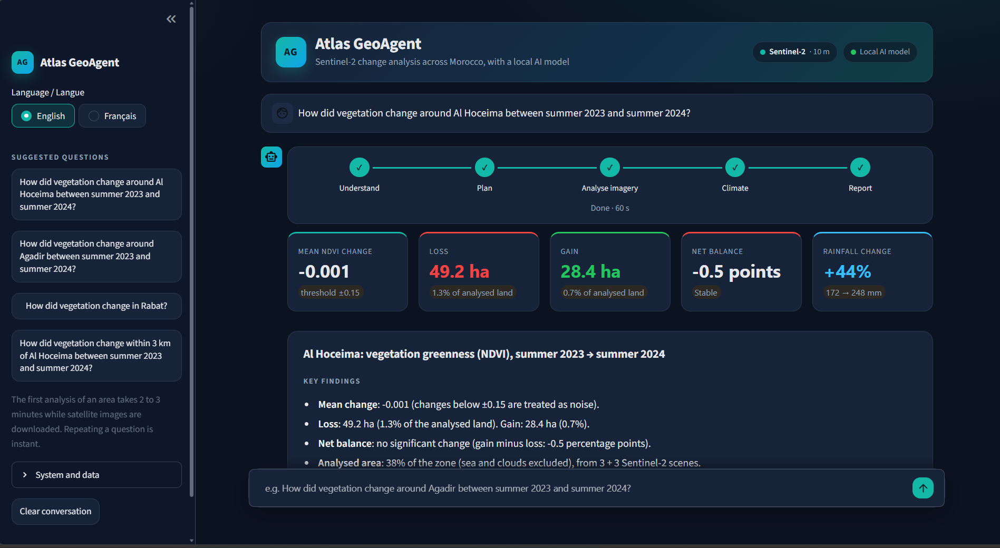
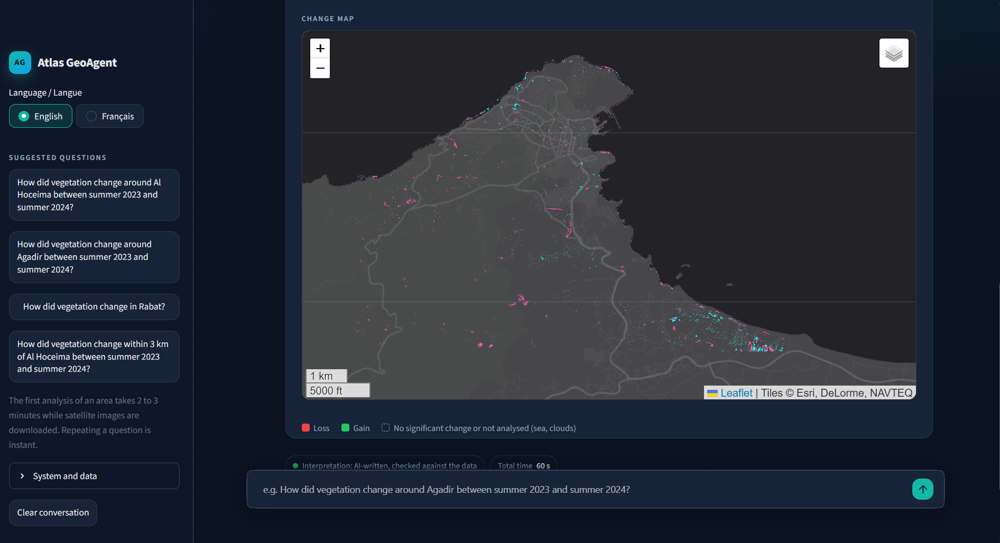
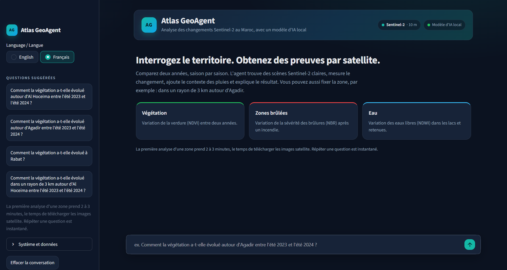
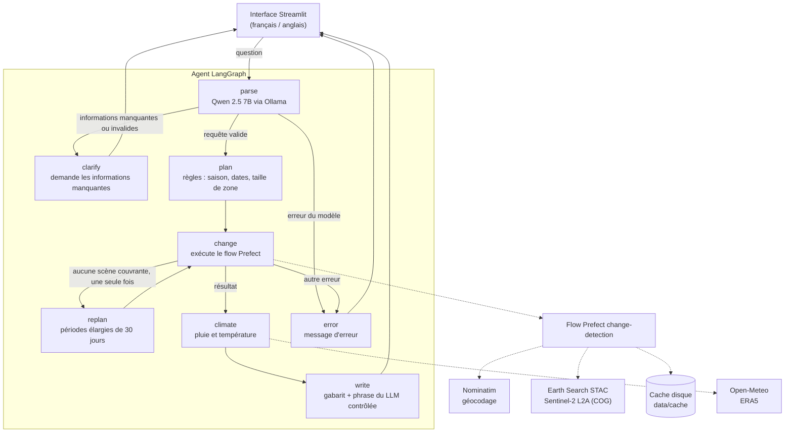
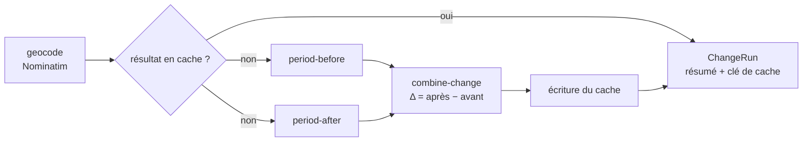
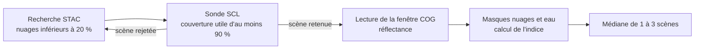

# Atlas GeoAgent

Assistant conversationnel pour analyser les changements de végétation, de zones brûlées et d'eau à partir d'images Sentinel-2 Level-2A, avec un modèle de langage exécuté localement.

## Table des matières

1. [Présentation du projet](#1-présentation-du-projet)
2. [Contexte et objectifs](#2-contexte-et-objectifs)
3. [Aperçu de l'application](#3-aperçu-de-lapplication)
4. [Fonctionnalités principales](#4-fonctionnalités-principales)
5. [Architecture du système](#5-architecture-du-système)
6. [Technologies utilisées](#6-technologies-utilisées)
7. [Méthodologie scientifique et traitement des données](#7-méthodologie-scientifique-et-traitement-des-données)
8. [Sources de données](#8-sources-de-données)
9. [Structure du dépôt](#9-structure-du-dépôt)
10. [Prérequis](#10-prérequis)
11. [Installation et configuration](#11-installation-et-configuration)
12. [Lancement de l'application](#12-lancement-de-lapplication)
13. [Exemples d'utilisation](#13-exemples-dutilisation)
14. [Tests et évaluation expérimentale](#14-tests-et-évaluation-expérimentale)
15. [Limites connues](#15-limites-connues)
16. [Perspectives d'amélioration](#16-perspectives-damélioration)
17. [Crédits](#17-crédits)

## 1. Présentation du projet

Atlas GeoAgent permet de poser, en français ou en anglais, une question telle que « Comment la végétation a-t-elle évolué autour d'Agadir entre l'été 2023 et l'été 2024 ? ». L'application recherche des images Sentinel-2 Level-2A, masque les nuages et l'eau, calcule un indice spectral (NDVI, NBR ou NDWI) pour deux périodes, mesure la différence, ajoute un contexte de précipitations et produit un rapport accompagné d'une carte des changements.

Le projet est un projet universitaire réalisé à la Faculté des Sciences et Techniques d'Al Hoceima. Il s'exécute entièrement en local : le modèle de langage (Qwen 2.5 7B) est servi par Ollama et l'interface est une application Streamlit. Il n'est pas hébergé publiquement.

Principe de conception : le modèle de langage intervient le moins possible. Il lit la question (sept champs structurés) et reformule une phrase d'interprétation. Les dates, la validation, les calculs, les surfaces, le verdict et la tendance des précipitations sont calculés par du code déterministe.

## 2. Contexte et objectifs

Mesurer l'évolution d'une zone à partir de Sentinel-2 suppose de savoir interroger un catalogue STAC, sélectionner des scènes peu nuageuses, lire uniquement la zone utile dans des fichiers volumineux, calibrer les réflectances, masquer les pixels invalides puis comparer deux périodes de manière cohérente. Atlas GeoAgent automatise cette chaîne et la rend interrogeable en langage naturel.

Objectifs du projet :

- proposer une interface conversationnelle bilingue (français et anglais) ;
- implémenter une chaîne de traitement reproductible, avec cache et exécution parallèle des deux périodes ;
- encadrer le modèle de langage par des règles et des contrôles, plutôt que de lui faire confiance pour les nombres et les dates ;
- fonctionner localement, sans service d'intelligence artificielle distant ;
- évaluer honnêtement chaque composant, y compris ses limites.

## 3. Aperçu de l'application

Écran d'accueil :



Résultat d'une analyse (cartes de métriques et rapport) :



Carte des changements (rouge : perte, vert : gain) :



Interface en français :



## 4. Fonctionnalités principales

- **Questions en langage naturel**, en français ou en anglais. La langue choisie dans la barre latérale détermine la langue de la réponse à la question suivante.
- **Trois indices spectraux** : NDVI (verdure de la végétation), NBR (sévérité des brûlures), NDWI (eau libre). L'indice est déduit des mots de la question (par exemple « incendie » pour NBR, « lac » pour NDWI) ; NDVI est l'indice par défaut.
- **Taille de la zone** réglable dans la question (« dans un rayon de 3 km autour d'Al Hoceima », « une zone de 5 km autour de Nador »). Les notions exactes sont définies en [section 7.10](#710-zone-détude).
- **Demande d'informations manquantes** : si le lieu, la saison ou les deux années manquent, l'agent pose la question au lieu de deviner.
- **Validation avant tout téléchargement** : année antérieure à 2019, deux années identiques, période non terminée, taille de zone hors limites.
- **Nouvelle tentative** : si aucune scène ne couvre correctement la zone, l'agent élargit une fois les deux périodes de 30 jours.
- **Pipeline Prefect** : les deux périodes sont traitées en parallèle, avec reprises uniquement sur les erreurs réseau, et un cache sur disque.
- **Rapport structuré** : principaux résultats chiffrés, une phrase d'interprétation contrôlée, limites, et téléchargement au format Markdown avec les sources de données.
- **Carte interactive** Folium avec trois fonds de carte (sombre, satellite, rues).
- **Exécution locale** du modèle de langage.
- **Portée géographique** : aucune restriction géographique n'est codée. Le géocodage (Nominatim) et Sentinel-2 L2A ont une couverture mondiale, mais l'application n'a été utilisée avec succès qu'au Maroc (Al Hoceima et Agadir). Une couverture mondiale n'est donc pas garantie.

## 5. Architecture du système

### 5.1 Workflow de l'agent (LangGraph)



LangGraph sert au routage : le modèle de langage ne choisit pas d'outils. Le seul cycle du graphe est la nouvelle tentative `replan`, limitée à une exécution (`MAX_REPLANS = 1`) et déclenchée uniquement lorsque le message d'erreur indique qu'aucune scène ne couvre la zone.

### 5.2 Flow Prefect



Trois tâches Prefect existent : `geocode`, `period-composite` (lancée deux fois en parallèle avec `.submit()`, pour l'avant et l'après) et `combine-change`. La lecture et l'écriture du cache sont réalisées dans le corps du flow, pas dans des tâches. Les étapes climat et rédaction du rapport sont des nœuds LangGraph et ne passent pas par Prefect.

### 5.3 Traitement d'une période



### 5.4 Répartition des responsabilités

| Couche | Dossier | Rôle |
|---|---|---|
| Science | `tools/` | Géocodage, recherche STAC, lecture des rasters, indices, détection de changement, climat. Aucun appel au LLM |
| Orchestration | `pipeline/` | Flow Prefect (parallélisme, reprises) et cache sur disque |
| Agent | `agent/` | Analyse de la question, règles de validation, rédaction du rapport, graphe LangGraph |
| Interface | `app/` | Application Streamlit bilingue, carte, affichage du rapport |

## 6. Technologies utilisées

Versions de l'environnement de développement (`pip freeze`, Python 3.14.0 sous Windows). Le fichier `requirements.txt` ne fixe que des versions minimales.

| Domaine | Technologie | Version | Usage dans le projet |
|---|---|---|---|
| Langage | Python | 3.14.0 | Ensemble du code |
| Interface | Streamlit | 1.67.0 | Application web locale |
| Carte | Folium, streamlit-folium | 0.20.0, 0.27.4 | Carte Leaflet dans Streamlit |
| Agent | LangGraph | 1.2.20 | Graphe d'états de l'agent |
| Orchestration | Prefect | 3.9.2 | Flow, tâches parallèles, reprises |
| LLM | Ollama (serveur), client Python `ollama` | version du serveur non relevée, client 0.6.3 | Exécution locale du modèle |
| Modèle | Qwen 2.5 7B (tag `qwen2.5:7b`) | — | Analyse de la question, phrase d'interprétation |
| Catalogue STAC | pystac-client | 0.9.1 | Recherche des scènes Sentinel-2 |
| Raster | rasterio | 1.5.2 | Lecture par fenêtre de fichiers COG distants, reprojection des limites |
| Calcul | NumPy | 2.5.4 | Indices, médianes, masques |
| Validation | pydantic | 2.14.2 | Structures de données typées |
| Requêtes HTTP | requests | 2.34.2 | Nominatim et Open-Meteo |
| Figures | Matplotlib | 3.11.2 | Scripts d'évaluation et de démonstration |
| Tests | pytest | 9.2.0 | Suite de tests hors ligne |

Services externes appelés à l'exécution : Earth Search (STAC), fichiers COG hébergés sur AWS, Nominatim, Open-Meteo (archive ERA5), tuiles de carte Esri et OpenStreetMap.

## 7. Méthodologie scientifique et traitement des données

### 7.1 Données

Collection `sentinel-2-l2a` du catalogue Earth Search (STAC), c'est-à-dire des produits Sentinel-2 de niveau 2A (réflectance de surface corrigée de l'atmosphère). Bandes utilisées selon l'indice :

| Indice | Bandes (assets Earth Search) | Usage |
|---|---|---|
| NDVI | `nir` (B08), `red` (B04) | Végétation |
| NBR | `nir` (B08), `swir22` (B12) | Brûlures |
| NDWI | `green` (B03), `nir` (B08) | Eau libre |

Le masque de nuages repose sur la couche de classification de scène `scl`. Une scène doit aussi fournir les assets `blue` et `swir16` pour être éligible (ils ne servent pas aux trois indices). Les bandes à 20 m (`swir22`, `scl`) sont rééchantillonnées sur la grille à 10 m de la bande `red` (interpolation bilinéaire pour les réflectances, plus proche voisin pour `scl`).

### 7.2 Recherche des scènes

Pour chaque période, requête STAC sur la zone et l'intervalle `{début}T00:00:00Z/{fin}T23:59:59Z`, avec le filtre `eo:cloud_cover < MAX_CLOUD_COVER` (20 par défaut), 200 résultats au plus. Les scènes sont triées par couverture nuageuse croissante et les 10 meilleures sont conservées. Une scène est ignorée si un asset requis ou ses métadonnées de calibration manquent.

### 7.3 Sélection des scènes

Pour chaque scène candidate, dans l'ordre :

1. **Sonde** : lecture de la seule couche `scl` sur la zone (opération peu coûteuse).
2. **Couverture utile** : proportion de pixels dont la classe `scl` n'est pas invalide. La scène est rejetée si cette proportion est inférieure à 0,9 (`min_coverage`). L'eau n'est pas comptée comme invalide à cette étape, sinon une zone côtière serait rejetée.
3. **Cohérence de grille** : la forme du raster doit être identique à celle de la première scène retenue.
4. **Lecture des bandes** puis calcul de l'indice.

Le processus s'arrête à 3 scènes retenues par période (`max_scenes`). Si aucune scène n'est retenue, une erreur est levée.

### 7.4 Lecture et calibration

Seule la fenêtre correspondant à la zone est lue dans les fichiers COG distants (requêtes HTTP partielles). La réflectance est calculée avec l'échelle et le décalage lus dans les métadonnées STAC (`raster:bands`) de chaque scène :

$$\rho = \max(0,\; DN \times s + o)$$

Sur les deux scènes inspectées pendant le développement (lignes de base de traitement 05.00 et 05.11), `s = 0,0001` et `o = −0,1`. Une scène sans ces métadonnées est ignorée : le décalage n'est jamais deviné.

### 7.5 Masques

Classes `scl` considérées comme invalides : 0 (pas de données), 1 (saturé ou défectueux), 3 (ombre de nuage), 8 et 9 (nuage de probabilité moyenne et élevée), 10 (cirrus fin), 11 (neige ou glace). L'eau (classe 6) est masquée pour NDVI et NBR, et conservée pour NDWI. Les pixels masqués valent `NaN`.

### 7.6 Indices spectraux

$$NDVI = \frac{\rho_{NIR} - \rho_{Rouge}}{\rho_{NIR} + \rho_{Rouge}} \qquad NBR = \frac{\rho_{NIR} - \rho_{SWIR22}}{\rho_{NIR} + \rho_{SWIR22}} \qquad NDWI = \frac{\rho_{Vert} - \rho_{NIR}}{\rho_{Vert} + \rho_{NIR}}$$

Si le dénominateur est nul, la valeur est `NaN`.

### 7.7 Composite par période

Pour chaque période, l'indice est calculé scène par scène, puis la médiane pixel par pixel est prise sur les scènes retenues, en ignorant les `NaN`. La médiane limite l'effet des nuages résiduels et du bruit (voir [section 14.3](#143-expériences-synthétiques)).

### 7.8 Comparaison temporelle

On compare toujours la même saison de deux années différentes, afin de ne pas confondre changement et cycle saisonnier. Les saisons sont météorologiques : hiver de décembre (année précédente) à février, printemps de mars à mai, été de juin à août, automne de septembre à novembre.

$$\Delta(x) = I_{apr\grave{e}s}(x) - I_{avant}(x)$$

### 7.9 Classification, surfaces et bilan

Seuil de bruit $\tau$ : 0,15 pour NDVI, 0,10 pour NBR, 0,15 pour NDWI (`DEFAULT_THRESHOLDS`). C'est un choix de conception, dont la sensibilité est étudiée en [section 14.4](#144-sensibilité-aux-seuils).

- perte si $\Delta \le -\tau$, gain si $\Delta \ge +\tau$, stable sinon ;
- surface d'un pixel : $A_{px} = |a \cdot e| / 10\,000$ hectares, où $a$ et $e$ sont les dimensions du pixel en mètres dans la projection UTM du raster ;
- surface de perte (resp. de gain) : nombre de pixels classés perte (resp. gain) multiplié par $A_{px}$ ;
- pourcentages : rapportés à la surface des pixels valides (non `NaN`) ;
- **bilan net** en points de pourcentage : gain % − perte %. Le verdict est « stable » si $|bilan| < 1$ point, sinon « hausse » ou « déclin » ;
- **tendance des précipitations** : « plus humide » si la variation est d'au moins +10 %, « plus sec » si elle est d'au plus −10 %, « similaire » sinon.

### 7.10 Zone d'étude

La zone est un carré centré sur le point renvoyé par le géocodeur.

| Notion | Définition dans le code | Valeur par défaut | Limites |
|---|---|---|---|
| Demi-côté (`half_size_km`, `DEFAULT_HALF_SIZE_KM`) | Distance du lieu à chaque bord du carré | 5 km | 0,5 à 10 km |
| Côté | 2 × demi-côté | 10 km | 1 à 20 km |
| Surface | côté², calculée approximativement à partir de degrés | environ 100 km² | au plus `MAX_AOI_KM2` = 400 km² |

Dans la question :

- « dans un rayon de X km », « within X km » : demi-côté = X (le résultat est un **carré**, pas un cercle : « within 3 km » donne un carré de 6 × 6 km) ;
- « une zone de X km », « a X km zone » : côté = X, donc demi-côté = X / 2 ;
- un nombre de kilomètres sans précision est traité comme un rayon.

La zone effectivement lue est alignée sur la grille de pixels UTM : par exemple 1006 × 1011 pixels ont été observés pour la zone par défaut de 10 km. Le rapport affiche toujours « Zone : côté × côté km ». La taille doit être écrite en chiffres : une valeur écrite en lettres (« three km ») est ignorée et la taille par défaut est utilisée.

### 7.11 Contexte climatique

Données ERA5 via l'API d'archive d'Open-Meteo : température moyenne quotidienne à 2 m et cumul quotidien de précipitations. Pour chaque période, la fenêtre est de 365 jours se terminant **à la fin de la période** (`fin − 364 jours` à `fin`), c'est-à-dire qu'elle inclut la saison analysée. Sont calculés le cumul de précipitations, la température moyenne et le nombre de jours pluvieux (au moins 1 mm). L'archive n'est disponible que jusqu'à 5 jours avant la date du jour ; en cas d'indisponibilité, le rapport est produit sans la ligne de précipitations.

### 7.12 Analyse de la question et validation

Le modèle extrait sept champs : `place`, `index`, `season`, `before_year`, `after_year`, `distance_km`, `distance_kind`. La sortie est contrainte par un schéma JSON (paramètre `format` d'Ollama, température 0). Une distance qui n'apparaît pas en chiffres dans la question est supprimée, car un petit modèle peut inventer un nombre.

Le planificateur (`agent/planner.py`), sans LLM, vérifie : lieu présent, saison présente, deux années présentes, première année supérieure ou égale à 2019 (`MIN_YEAR`), années différentes, période terminée, côté de zone entre 1 et 20 km. Il transforme ensuite saison et années en dates. En cas de problème, l'agent pose une question à l'utilisateur et aucun téléchargement n'est lancé.

### 7.13 Rapport et contrôle de la phrase du LLM

Le rapport est assemblé par un gabarit (titre, changement moyen, pertes et gains, bilan net, surface analysée, zone, précipitations, limites) dont tous les nombres sont calculés par le code. Le LLM écrit une seule phrase d'interprétation (au plus deux phrases conservées). Elle n'est affichée que si elle passe les contrôles suivants :

1. une phrase coupée par la limite de tokens est tronquée à la dernière phrase complète ;
2. elle ne contient aucun nom de champ interne ;
3. chaque nombre cité existe dans les données (tolérance d'une demi-unité de la dernière décimale écrite) ;
4. elle ne contredit pas le verdict ni la tendance des précipitations (règles par expressions régulières).

Sinon, une phrase issue d'une table de règles (12 combinaisons de verdict et de tendance, en français et en anglais) est utilisée. Ces contrôles garantissent la cohérence avec les données, pas la qualité de l'explication.

### 7.14 Gestion des erreurs et cache

- Chaque outil lève une exception dédiée (`GeocodingError`, `ImagerySearchError`, `RasterReadError`, `ChangeDetectionError`, `ClimateError`, `LLMError`, `ParseError`) dont le message est lisible par l'agent ; l'interface affiche une erreur au lieu d'une trace.
- Les tâches Prefect sont relancées (2 reprises, délai de 2 s pour `geocode` et de 5 s pour `period-composite`) uniquement si l'erreur, ou l'une de ses causes, est de type réseau ou entrée-sortie (`requests.RequestException`, `APIError` de pystac-client, `RasterioError`). Une erreur du type « aucune scène » n'est pas relancée.
- **Cache** : clé = empreinte SHA-256 (16 premiers caractères) de l'outil, de la boîte englobante arrondie à 5 décimales, des périodes, de l'indice et du seuil. Le dossier `data/cache/<clé>/` contient `delta.npz`, `meta.json` et `summary.json`, ce dernier étant écrit en dernier : une entrée sans `summary.json` ou illisible est considérée comme absente. La clé ne contient ni `MAX_CLOUD_COVER`, ni la version du code : après un changement de ces paramètres, il faut vider `data/cache/`.

## 8. Sources de données

| Source | Utilisation | Lien |
|---|---|---|
| Copernicus Sentinel-2 (ESA) | Images Level-2A | [Mission Sentinel-2](https://sentinels.copernicus.eu/web/sentinel/missions/sentinel-2) |
| Earth Search (Element 84) | Catalogue STAC et accès aux fichiers COG | [earth-search.aws.element84.com/v1](https://earth-search.aws.element84.com/v1) |
| Open-Meteo, données ERA5 | Température et précipitations | [Historical Weather API](https://open-meteo.com/en/docs/historical-weather-api) |
| Nominatim (OpenStreetMap) | Géocodage des noms de lieux | [Documentation](https://nominatim.org/release-docs/latest/api/Search/), [politique d'usage](https://operations.osmfoundation.org/policies/nominatim/) |
| OpenStreetMap, Esri | Fonds de carte | [Licence OpenStreetMap](https://www.openstreetmap.org/copyright) |

Attribution : contient des données Copernicus Sentinel-2 modifiées (ESA). Données météorologiques ERA5 (ECMWF) distribuées par Open-Meteo. © contributeurs OpenStreetMap. Tuiles © Esri.

**Données transmises à des services externes** : le nom du lieu (Nominatim), la boîte englobante de la zone (API STAC et serveurs de fichiers COG), les coordonnées arrondies du lieu (Open-Meteo) et les requêtes de tuiles de carte. Le texte complet de la question et le rapport restent sur la machine.

## 9. Structure du dépôt

```text
.
├── app/                    # Interface Streamlit
│   ├── streamlit_app.py    #   page principale
│   ├── i18n.py             #   textes français et anglais
│   ├── components.py       #   éléments HTML (en-tête, étapes, légende)
│   ├── styles.py           #   feuille de style
│   ├── report_view.py      #   découpage du rapport en sections
│   ├── viz.py              #   carte Folium et superposition des changements
│   ├── export.py           #   texte et nom du rapport téléchargé
│   └── brand.py            #   nom du produit
├── agent/                  # Agent et règles
│   ├── graph.py            #   graphe LangGraph
│   ├── parser.py           #   analyse de la question par le LLM
│   ├── planner.py          #   validation, dates, taille de zone, replanification
│   ├── writer.py           #   rapport, verdict, contrôle de la phrase du LLM
│   ├── llm.py              #   appel à Ollama
│   ├── prompts.py          #   consignes envoyées au modèle
│   └── settings.py         #   réglages de l'agent
├── tools/                  # Traitements géospatiaux, sans LLM
│   ├── geocoding.py, search_imagery.py, raster.py
│   ├── indices.py, change.py, climate.py, schemas.py
├── pipeline/               # Orchestration
│   ├── flows.py            #   flow et tâches Prefect
│   └── caching.py          #   cache sur disque
├── eval/                   # Évaluation expérimentale
│   ├── questions.py, baseline_parser.py, parsing_benchmark.py
│   ├── synthetic.py, threshold_sweep.py, events.py, narrative_rate.py
│   └── results/            #   fichiers de résultats générés
├── tests/                  # Tests automatisés (118)
├── assets/screenshots/     # Captures d'écran du README
├── data/                   # Cache et sorties (non versionnés)
├── config.py               # Réglages (variables d'environnement)
├── requirements.txt
├── check_offsets.py        # Affiche la calibration STAC de deux scènes
├── view_change.py          # Dessine une carte de changement mise en cache
└── demo_step1.py … demo_step5.py, demo_step4b.py   # Scripts de démonstration du développement
```

## 10. Prérequis

- **Système** : développé et utilisé sous Windows. Linux et macOS n'ont pas été testés.
- **Python** : 3.14.0 (environnement de développement). Les versions de la [section 6](#6-technologies-utilisées) sont celles réellement installées.
- **Ollama** et le modèle `qwen2.5:7b` (environ 4,7 Go à télécharger).
- **Mémoire** : 16 Go de RAM sur la machine de développement ; le modèle occupe environ 5 Go.
- **Connexion Internet** : images Sentinel-2, géocodage, précipitations et fonds de carte.
- **Performances mesurées** sur la machine de développement : génération d'environ 5,07 tokens par seconde et lecture du prompt d'environ 11,9 tokens par seconde (mesure `ollama run --verbose`). Ces valeurs dépendent du matériel.

## 11. Installation et configuration

Depuis la racine du dépôt (clone du dépôt ou archive décompressée), sous PowerShell :

```powershell
python -m venv .venv
.venv\Scripts\Activate.ps1
python -m pip install --upgrade pip
pip install -r requirements.txt
```

Installer [Ollama](https://ollama.com/download), puis télécharger le modèle :

```powershell
ollama pull qwen2.5:7b
ollama list
```

### Configuration de Nominatim

Nominatim exige un `User-Agent` identifiant le projet et un contact. La valeur par défaut de `config.py` (`your-email@example.com`) est factice et a été rejetée par le service (erreur HTTP 403) pendant le développement. Il faut la remplacer par une adresse réelle, soit dans `config.py`, soit par variable d'environnement :

```powershell
$env:USER_AGENT = "atlas-geoagent/0.1 (contact: votre-adresse@exemple.com)"
```

### Variables d'environnement

| Variable | Valeur par défaut | Rôle |
|---|---|---|
| `STAC_URL` | `https://earth-search.aws.element84.com/v1` | Catalogue STAC |
| `STAC_COLLECTION` | `sentinel-2-l2a` | Collection interrogée |
| `MAX_CLOUD_COVER` | `20` | Couverture nuageuse maximale d'une scène, en % |
| `NOMINATIM_URL` | `https://nominatim.openstreetmap.org/search` | Service de géocodage |
| `USER_AGENT` | valeur factice | Contact transmis à Nominatim |
| `MAX_AOI_KM2` | `400` | Surface maximale de la zone, en km² |
| `DEFAULT_HALF_SIZE_KM` | `5` | Demi-côté par défaut de la zone, en km |
| `OLLAMA_MODEL` | `qwen2.5:7b` | Modèle local |
| `OLLAMA_HOST` | `http://127.0.0.1:11434` | Adresse du serveur Ollama |
| `OLLAMA_KEEP_ALIVE` | `30m` | Durée de conservation du modèle en mémoire |
| `LLM_TIMEOUT_S` | `180` | Délai maximal d'une requête au modèle, en secondes |
| `REPORT_LANGUAGE` | `en` | Langue par défaut des rapports (l'application la fixe à chaque question) |

Constantes du code (non configurables par variable) : première année acceptée 2019 (`MIN_YEAR`), une replanification au plus (`MAX_REPLANS`), seuils par indice, couverture utile minimale 0,9, 3 scènes au plus par période.

### Tests

```powershell
pytest -q
```

Les tests s'exécutent hors ligne et sans Ollama.

## 12. Lancement de l'application

```powershell
streamlit run app/streamlit_app.py
```

L'application est disponible sur `http://localhost:8501`. Si le port est occupé : `--server.port 8502`.

Option recommandée : démarrer un serveur Prefect dans un second terminal avant l'application.

```powershell
prefect server start
```

L'application détecte automatiquement le serveur (`http://127.0.0.1:4200/api/health`). Sans lui, Prefect démarre un serveur temporaire à chaque question, ce qui a coûté environ 15 secondes pendant le développement.

Durées mesurées sur la machine de développement : traitement à froid d'une zone de 10 km avec les deux périodes en parallèle, environ 100 secondes (contre environ 200 secondes en séquentiel) ; question complète à froid de 130 à 213 secondes selon la zone ; question déjà en cache, environ 64 à 71 secondes, presque entièrement consacrées au modèle de langage.

## 13. Exemples d'utilisation

Une question complète contient **un lieu, une saison et deux années** :

> Comment la végétation a-t-elle évolué autour de Rabat entre l'hiver 2022 et l'hiver 2024 ?

> How did vegetation change around Agadir between summer 2023 and summer 2024?

| Objectif | Formulation |
|---|---|
| Végétation (NDVI, par défaut) | végétation, verdure, forêt, cultures |
| Zones brûlées (NBR) | incendie, brûlé, fire, wildfire |
| Eau (NDWI) | eau, lac, retenue, inondation, water, lake, reservoir |
| Zone autour du lieu | « dans un rayon de 3 km autour de X » (carré de 6 × 6 km) ou « une zone de 5 km autour de X » |

Si une information manque, l'agent la demande. Exemple : « Comment la végétation a-t-elle évolué à Rabat ? » provoque une demande de saison et d'années. Les dates relatives (« l'été dernier ») ne sont pas comprises : indiquer l'année.

Lecture du résultat :

| Élément | Signification |
|---|---|
| Changement moyen | Moyenne de Δ sur les pixels valides ; les variations inférieures au seuil sont traitées comme du bruit |
| Perte, gain | Surface en hectares et en % des terres analysées où l'indice a diminué ou augmenté d'au moins le seuil |
| Bilan net | Gain moins perte, en points de pourcentage ; « stable » en dessous de 1 point |
| Variation des pluies | Comparaison des précipitations des deux fenêtres de 365 jours |
| Zone | Carré réellement analysé, centré sur le lieu |
| Surface analysée | Part de la zone exploitable (mer, nuages et absence de données exclus) |
| Interprétation | Une phrase prudente, écrite par le modèle et contrôlée, ou issue de règles. Ce n'est pas une preuve de cause |

Sur la carte, le rouge indique une perte, le vert un gain, et la transparence l'absence de changement significatif ou une zone non analysée ; plus la couleur est intense, plus le changement est fort. Le bouton de couches permet de passer du fond sombre au fond satellite ou au fond de rues.

Problèmes fréquents :

| Symptôme | Action |
|---|---|
| `Geocoding service failed: 403` | Renseigner un `USER_AGENT` réel (section 11) |
| `Local LLM unavailable` | Démarrer Ollama et exécuter `ollama pull qwen2.5:7b` |
| `No scene ... covers the area` | La zone peut chevaucher le bord d'une tuile Sentinel-2 ou la période être trop nuageuse : changer de saison, d'années, réduire la zone ou déplacer le lieu |
| Fond de carte vide | Vérifier la connexion Internet, essayer le fond « Streets » |
| Question mal comprise | Reformuler sur le modèle « entre l'été 2023 et l'été 2024 » |

## 14. Tests et évaluation expérimentale

Les résultats sont enregistrés dans `eval/results/`. Chaque expérience ci-dessous précise son protocole, ses données, ses métriques, ses résultats et ses limites.

### 14.1 Tests logiciels

- **Protocole** : `pytest -q`. Les tests sont hors ligne, sans Ollama ni accès réseau ; le LLM, les API et les rasters distants sont remplacés par des doublons de test ou des rasters synthétiques générés localement. L'interface Streamlit est testée avec `streamlit.testing.v1.AppTest`.
- **Résultat** : 118 tests (comptage de la suite actuelle).
- **Limites** : aucun taux de couverture de code n'a été mesuré. Les tests vérifient le comportement du code, pas la justesse scientifique des résultats sur des images réelles.

| Fichier | Tests | Contenu |
|---|---|---|
| `test_step1.py`, `test_raster.py`, `test_calibration.py` | 6 | Schémas, géocodage, lecture de raster synthétique, lecture de la calibration |
| `test_indices.py`, `test_step3.py` | 15 | Réflectance, masques, indices, composite médian, classification, surfaces |
| `test_step4.py`, `test_step4b.py` | 15 | Cache, reprises Prefect, parallélisme, outil climat |
| `test_step5.py`, `test_area.py` | 34 | Parser, planificateur, graphe LangGraph, contrôles du rapport, taille de zone |
| `test_step6.py`, `test_ui.py`, `test_product.py` | 31 | Interface bilingue, carte (couleurs réellement envoyées au navigateur), export |
| `test_eval.py` | 17 | Jeu de questions, métriques, baseline, expériences synthétiques, événements |

### 14.2 Benchmark d'analyse des questions

- **Protocole** (`python -m eval.parsing_benchmark`) : 47 questions étiquetées (31 en anglais, 16 en français). 35 sont complètes (dont 9 en formulation libre : minuscules, absence de préposition, langues mélangées, nombre écrit en lettres), 8 contiennent une information manquante, 4 enfreignent une règle (année trop ancienne, zone trop grande, années identiques, période future). Le modèle est `qwen2.5:7b`, température 0. Les mêmes questions sont analysées par une baseline à expressions régulières (`eval/baseline_parser.py`).
- **Métriques** : exactitude par champ et correspondance exacte de tous les champs (questions complètes) ; décision correcte sur les 47 questions, c'est-à-dire demander exactement les informations manquantes, refuser exactement les requêtes invalides et accepter les requêtes valides ; intervalles de Wilson à 95 %.

| Métrique | Baseline regex | LLM (qwen2.5:7b) |
|---|---|---|
| Correspondance exacte, 35 questions complètes | 80 % (IC 64 à 90) | 94 % (IC 81 à 98) |
| Correspondance exacte, 9 formulations libres | 33 % (IC 12 à 65) | 89 % (IC 56 à 98) |
| Décision correcte, 47 questions | 81 % (IC 67 à 90) | 100 % (IC 92 à 100) |
| Exactitude du lieu | 83 % | 100 % |
| Exactitude de la distance | 97 % | 94 % |
| Exactitude de la saison, des années, de l'indice | 100 % | 100 % |
| Correspondance exacte, anglais / français | 71 % / 93 % | 95 % / 93 % |
| Informations manquantes bien détectées (8) | 75 % | 100 % |
| Requêtes invalides bien refusées (4) | 75 % | 100 % |
| Temps moyen par question | négligeable | 12,9 s |

Le LLM commet deux erreurs : « Analyse une zone de 5 km autour de Nador » est lue comme un rayon (la zone analysée serait de 10 km au lieu de 5 km) et « within three km » est ignoré, car le garde-fou n'accepte que les chiffres. La baseline échoue notamment sur les noms de lieu en minuscules, sans préposition ou introduits par « by ».

- **Limites** : les questions et la baseline ont été écrites par l'auteur du système, sans jeu de test indépendant ; une seule exécution (température 0) ; l'échantillon des formulations libres est petit, d'où des intervalles larges. Les résultats sont indicatifs.

### 14.3 Expériences synthétiques

- **Protocole** (`python -m eval.synthetic`) : scènes d'indice synthétiques de 300 × 300 pixels. Paysage = bruit blanc filtré par un noyau gaussien (écart-type de 12 pixels), mis à l'échelle entre 0,15 et 0,65. 12 carrés de 12 à 29 pixels de côté, alternativement en perte et en gain d'amplitude $m \in \{0{,}10 ;\ 0{,}20 ;\ 0{,}30 ;\ 0{,}50\}$. Bruit gaussien par scène $\sigma \in \{0{,}03 ;\ 0{,}06 ;\ 0{,}10\}$ et 3 % de valeurs aberrantes (−0,5) simulant ombres et nuages résiduels. Comparaison d'une scène unique et d'une médiane de 3 scènes, avec les fonctions du pipeline réel (`median_composite`, `difference`, `classify_change`), seuil 0,15, moyenne sur 3 graines.
- **Métriques** : rappel (pixels réellement modifiés classés avec le bon signe), taux de faux positifs (pixels inchangés classés comme changement), précision, F1.

| Bruit σ | Changement réel | Scènes | Rappel | Faux positifs | Précision | F1 |
|---|---|---|---|---|---|---|
| 0,03 | ±0,10 | 1 | 14 % | 5,9 % | 12 % | 13 % |
| 0,03 | ±0,10 | médiane de 3 | 5 % | 0,5 % | 34 % | 9 % |
| 0,03 | ±0,20 | 1 | 86 % | 5,9 % | 45 % | 59 % |
| 0,03 | ±0,20 | médiane de 3 | 95 % | 0,5 % | 91 % | 93 % |
| 0,10 | ±0,20 | 1 | 63 % | 33,0 % | 10 % | 17 % |
| 0,10 | ±0,20 | médiane de 3 | 70 % | 13,3 % | 23 % | 35 % |

La grille complète figure dans `eval/results/synthetic.md`. La médiane de 3 scènes réduit nettement les faux positifs, mais à bruit élevé (σ = 0,10) ils restent à 13 %. Les changements inférieurs au seuil (±0,10) sont presque tous manqués : le seuil est le plus petit changement que l'application prétend détecter.

- **Limites** : bruit gaussien indépendant, recalage parfait, aucune phénologie, variation d'éclairement ni pixel mixte, patchs rectangulaires idéaux. Ces résultats valident la logique de détection dans un cadre contrôlé ; **ils ne mesurent pas la précision sur des images satellitaires réelles**.

### 14.4 Sensibilité aux seuils

- **Protocole** (`python -m eval.threshold_sweep`) : pour chaque analyse enregistrée dans le cache pendant le développement, les pertes et les gains sont recalculés à partir de $\Delta$ stocké pour $\tau \in \{0{,}05 ;\ 0{,}10 ;\ 0{,}15 ;\ 0{,}20 ;\ 0{,}25 ;\ 0{,}30\}$, sans nouveau téléchargement. Données : 8 entrées de cache (7 analyses distinctes, une analyse étant enregistrée deux fois) ; trois analyses identifiées sont présentées ici, NDVI, zone de 10 km. Métrique : surface en hectares et en % des pixels valides.

| Seuil | Al Hoceima, été 2023 → été 2024 : perte / gain | Al Hoceima, été 2021 → été 2025 : perte / gain | Agadir, été 2023 → été 2024 : perte / gain |
|---|---|---|---|
| ±0,05 | 323,6 ha (8,3 %) / 289,9 ha (7,4 %) | 329,4 ha (8,4 %) / 1522,1 ha (39,0 %) | 329,8 ha (3,9 %) / 723,6 ha (8,6 %) |
| ±0,10 | 102,2 ha (2,6 %) / 70,7 ha (1,8 %) | 115,9 ha (3,0 %) / 725,6 ha (18,6 %) | 108,7 ha (1,3 %) / 277,2 ha (3,3 %) |
| **±0,15** | **49,2 ha (1,3 %) / 28,4 ha (0,7 %)** | **52,7 ha (1,4 %) / 417,4 ha (10,7 %)** | **53,2 ha (0,6 %) / 159,9 ha (1,9 %)** |
| ±0,20 | 29,0 ha (0,7 %) / 14,3 ha (0,4 %) | 27,1 ha (0,7 %) / 283,7 ha (7,3 %) | 30,8 ha (0,4 %) / 107,8 ha (1,3 %) |
| ±0,25 | 19,1 ha (0,5 %) / 8,9 ha (0,2 %) | 16,4 ha (0,4 %) / 208,4 ha (5,3 %) | 20,2 ha (0,2 %) / 79,6 ha (0,9 %) |
| ±0,30 | 13,9 ha (0,4 %) / 6,3 ha (0,2 %) | 10,4 ha (0,3 %) / 157,4 ha (4,0 %) | 14,4 ha (0,2 %) / 60,6 ha (0,7 %) |

- **Résultats** : les surfaces absolues dépendent fortement du seuil (pour Al Hoceima 2023 → 2024, la perte passe de 324 ha à ±0,05 à 14 ha à ±0,30). Le sens du bilan reste le même à tous les seuils lorsque l'écart entre gain et perte est grand (Al Hoceima 2021 → 2025 et Agadir : gain supérieur à la perte). Pour Al Hoceima 2023 → 2024, la perte reste légèrement supérieure au gain à tous les seuils, avec un écart inférieur à 1 point au seuil par défaut. Dans plusieurs autres analyses du fichier `eval/results/threshold_sweep.md`, le signe du bilan s'inverse selon le seuil lorsque l'écart est inférieur à 1 point, ce qui motive l'étiquette « stable ».
- **Limites** : c'est une étude de sensibilité, pas une validation : aucune référence terrain n'est comparée. Le seuil par défaut reste un choix de conception.

### 14.5 Évaluation sur des événements réels

**Non réalisée.** L'outil `eval/events.py` est implémenté et testé unitairement sur un raster synthétique, mais aucun événement réel n'a été exécuté faute de temps. Le protocole prévu est le suivant : pour chaque événement vérifié dans une source fiable, une boîte « touchée » et une boîte « témoin » proche sont définies ; l'événement est validé si au moins 20 % des pixels de la boîte touchée sont classés dans le sens attendu et au moins deux fois plus que dans la boîte témoin (constantes `MIN_SHARE` et `MIN_RATIO`). Aucun résultat n'est donc publié et aucune affirmation de précision sur des images réelles n'est faite dans ce document.

## 15. Limites connues

- Une zone qui chevauche le bord d'une tuile Sentinel-2 peut échouer avec « no scene covers the area » : le mosaïquage de plusieurs tuiles n'est pas implémenté.
- Deux périodes d'une même saison seulement ; pas de tendance sur plusieurs années. Les dates relatives et les distances écrites en lettres ne sont pas comprises.
- Les précipitations ERA5 proviennent d'une grille grossière (de l'ordre de 25 km) : elles conviennent pour comparer des années, pas pour des cumuls locaux.
- Libellé du rapport : la ligne de précipitations affiche « 12 mois » précédant la période alors que la fenêtre calculée (365 jours) se termine à la fin de la période (section 7.11).
- Le cache n'est pas invalidé par un changement de `MAX_CLOUD_COVER` ou du code (section 7.14).
- Le géocodeur renvoie le premier résultat ; le centre d'une grande ville ne couvre qu'une partie de celle-ci. La zone est un carré aligné sur la grille UTM, de taille approximative.
- La calibration des réflectances est lue dans les métadonnées STAC ; elle n'a été contrôlée manuellement que sur deux scènes. La première année acceptée (2019) correspond à une hypothèse de couverture non vérifiée sur l'ensemble de l'archive.
- Les valeurs de réflectance négatives sont ramenées à 0, ce qui peut produire des `NaN` sur des pixels d'eau très sombres.
- Les résultats synthétiques ne mesurent pas la précision sur des images réelles ; aucune validation sur des événements réels n'a été faite.
- Sur CPU, le modèle local met environ une minute par question ; les contrôles rendent sa phrase cohérente avec les données, sans garantir qu'elle soit pertinente.
- Une seule session à la fois, sans authentification. Plateforme testée : Windows uniquement. Les tuiles de fond de carte Esri n'ont pas fait l'objet d'un test dédié.

## 16. Perspectives d'amélioration

- Évaluer sur des événements réels documentés (incendies, aménagements, retenues d'eau) avec l'outil `eval/events.py`.
- Constituer un jeu de questions indépendant, rédigé par plusieurs personnes, pour le benchmark d'analyse.
- Mosaïquer plusieurs tuiles pour les zones situées sur un bord de tuile.
- Comparer plus de deux périodes et estimer une tendance.
- Corriger le libellé de la fenêtre de précipitations et inclure les paramètres de sélection dans la clé de cache.
- Reconnaître les dates relatives et les nombres écrits en lettres.
- Épingler les versions des dépendances et conteneuriser l'application (Docker Compose avec un conteneur Ollama).
- Pour un déploiement partagé : GPU pour le modèle, file de tâches pour les analyses longues, authentification et limitation du débit.

## 17. Crédits

- **Auteur** : Bouich Mohamed, Faculté des Sciences et Techniques d'Al Hoceima, Université Abdelmalek Essaadi.
- **Données** : voir la [section 8](#8-sources-de-données) pour les sources et les attributions.
- **Logiciels et modèle** : Streamlit, Folium, LangGraph, Prefect, Ollama, Qwen 2.5 (Alibaba Cloud), pystac-client, rasterio, NumPy, Matplotlib, pydantic, requests, pytest.
- **Licence** : non définie à ce jour.
